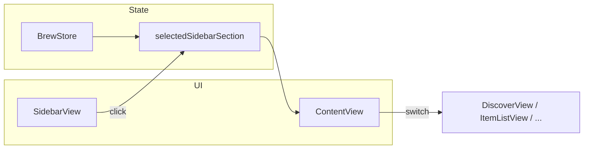

# Sidebar Navigation

This document describes the selection architecture of the left sidebar in the HomebrewCatalog app and the move from the `NavigationSplitView` + `List(selection:)` approach to `HSplitView` + explicit state management.

## Summary

| Before | After |
|--------|------|
| `NavigationSplitView` (3 columns) | Nested `HSplitView` (sidebar + content + detail) |
| `@State selectedSection: SidebarSection?` (in `ContentView`) | `BrewStore.selectedSidebarSection: SidebarSection` |
| `List(selection:)` + `.tag()` row tags | `Button` + `store.selectedSidebarSection = section` |
| `SidebarSection` as a nested enum in `ContentView` | `Models/SidebarSection.swift` as a standalone enum |

**Motivation:** On macOS, `List(selection:)` in the `.sidebar` style could silently ignore the selection when the `.tag()` value was applied inside a `@ViewBuilder` helper function; the user could not click any section. Explicit `Button`-based selection bypasses this SwiftUI limitation entirely.

## Architecture

### Files

| File | Responsibility |
|-------|------------|
| `Models/SidebarSection.swift` | Section identifiers, SF Symbol icons, badge counts |
| `Views/SidebarView.swift` | Grouped list UI, selection buttons, selected-row highlight |
| `Views/ContentView.swift` | `HSplitView` layout, section → middle-column view mapping |
| `ViewModels/BrewStore.swift` | `selectedSidebarSection` as the single source of truth |

## State flow

1. When the app launches, `BrewStore.selectedSidebarSection` defaults to `.discover`.
2. When the user clicks a row in `SidebarView`, `store.selectedSidebarSection` is updated.
3. The `switch store.selectedSidebarSection` in `ContentView.contentColumn` builds the corresponding view.
4. `.id(store.selectedSidebarSection)` forces the middle column to be rebuilt when the section changes.
5. `onChange(of: store.selectedSidebarSection)` resets the selected package identifier (`selectedItemID`); no stale detail is left behind when switching between sections.

## Section → view mapping

| Group | `SidebarSection` | Middle column | Detail column | Grid/List picker |
|------|------------------|------------|--------------|------------------|
| Browse | `discover` | `DiscoverView` | `DetailView` if a package is selected | No |
| Browse | `categories` | `CategoryBrowserView` | Yes | Yes |
| Browse | `formulas` | `ItemListView` (formulae) | Yes | Yes |
| Browse | `casks` | `ItemListView` (casks) | Yes | Yes |
| Installed | `installed` | `InstalledView` | Yes | Yes |
| Installed | `outdated` | `OutdatedView` | Yes | No |
| Installed | `pinned` | `PinnedView` | Yes | Yes |
| Installed | `leaves` | `LeavesView` | Yes | Yes |
| Library | `favorites` | `FavoritesView` | Yes | Yes |
| Library | `history` | `HistoryView` | Yes | Yes |
| Library | `groups` | `GroupsView` | Yes | Yes |
| Library | `actionHistory` | `ActionHistoryView` | No | No |
| System | `services` | `ServicesView` | No | No |
| System | `taps` | `TapsView` | No | No |
| System | `masApps` | `MASView` | No | No |
| System | `systemHealth` | `SystemHealthView` | No | No |
| System | `settings` | `SettingsView` | No | No |

`showsViewModePicker` shows the segmented picker in the toolbar only for sections that support switching between grid and list.

## Badges

`SidebarSection.badgeCount(from:)` currently shows a count only for:

- **Outdated** — `store.outdatedCount > 0`
- **Installed** — `store.installedCount > 0`

The badge is hidden when the count is zero or `nil`. Instead of the native `.badge()`, the badge is drawn as a `Text` with a capsule background (for a consistent look inside the sidebar `List`).

## Adding a new section

1. Add a new `case` to the `SidebarSection` enum; assign it an SF Symbol in the `icon` switch.
2. If needed, add the counting logic to `badgeCount(from:)`.
3. Add `sidebarButton(.yeniBolum)` to the appropriate `Section` block in `SidebarView`.
4. Add the matching view to the `ContentView.contentColumn` switch.
5. If a grid/list picker is needed, add a case to the `showsViewModePicker` switch.
6. If you use `project.yml` / XcodeGen and added a new file, run `xcodegen generate`.

## Why not `List(selection:)`?

Root-cause analysis in brief:

- When `.tag(section)` sits inside a `@ViewBuilder` helper (`sidebarRow` / `row`), selection matching in the macOS sidebar `List` does not work reliably.
- In the same project, `ItemListView` **works** with `List(selection:)` + an inline `.tag(item.id)`; the difference is that the tag is directly in the `List` body.
- Alternative fixes for the sidebar (an optional-cast tag, an inline tag) were tried; explicit `Button` + `BrewStore` state was chosen as the lasting solution.

## Verification checklist

Manual test (after `xcodebuild -scheme HomebrewCatalog build`):

- [ ] Clicking any sidebar row switches the middle column to the corresponding screen.
- [ ] The selected row is highlighted with an accent-colored background.
- [ ] When the section changes, the detail column is cleared (no detail of the previous package remains).
- [ ] The Outdated / Installed badges show the correct count once loaded.
- [ ] Row selection (`ItemListView`) in the Formulae / Casks lists still works.
- [ ] The toolbar search field calls `store.search` in every section.

## Related documents

- `Docs/PRD.md` — Product scope and overall architecture
- `README.md` — Build and test commands
