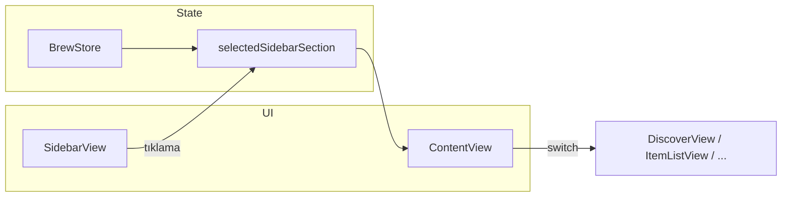

# Sidebar Navigasyonu

Bu belge, HomebrewCatalog uygulamasındaki sol kenar çubuğu (sidebar) seçim mimarisini ve `NavigationSplitView` + `List(selection:)` yaklaşımından `HSplitView` + açık durum yönetimine geçişi açıklar.

## Özet

| Önceki | Yeni |
|--------|------|
| `NavigationSplitView` (3 sütun) | İç içe `HSplitView` (sidebar + içerik + detay) |
| `@State selectedSection: SidebarSection?` (`ContentView` içinde) | `BrewStore.selectedSidebarSection: SidebarSection` |
| `List(selection:)` + `.tag()` satır etiketleri | `Button` + `store.selectedSidebarSection = section` |
| `SidebarSection` `ContentView` içinde nested enum | `Models/SidebarSection.swift` bağımsız enum |

**Motivasyon:** macOS’ta `.sidebar` stilinde `List(selection:)`, `.tag()` değerinin `@ViewBuilder` yardımcı fonksiyonunun içinde uygulanması durumunda seçimi sessizce yok sayabiliyordu; kullanıcı hiçbir bölüme tıklayamıyordu. Açık `Button` tabanlı seçim bu SwiftUI sınırını tamamen bypass eder.

## Mimari

### Dosyalar

| Dosya | Sorumluluk |
|-------|------------|
| `Models/SidebarSection.swift` | Bölüm kimlikleri, SF Symbol ikonları, rozet sayıları |
| `Views/SidebarView.swift` | Gruplu liste UI, seçim butonları, seçili satır vurgusu |
| `Views/ContentView.swift` | `HSplitView` düzeni, bölüm → orta sütun view eşlemesi |
| `ViewModels/BrewStore.swift` | `selectedSidebarSection` tek kaynak (single source of truth) |

## Durum akışı

1. Uygulama açıldığında `BrewStore.selectedSidebarSection` varsayılan olarak `.discover` değerindedir.
2. Kullanıcı `SidebarView` içinde bir satıra tıkladığında `store.selectedSidebarSection` güncellenir.
3. `ContentView.contentColumn` içindeki `switch store.selectedSidebarSection` ilgili view’ı oluşturur.
4. `.id(store.selectedSidebarSection)` orta sütunun bölüm değişiminde yeniden oluşturulmasını sağlar.
5. `onChange(of: store.selectedSidebarSection)` seçili paket kimliğini (`selectedItemID`) sıfırlar; bölümler arası geçişte eski detay kalıntısı kalmaz.

## Bölüm → görünüm eşlemesi

| Grup | `SidebarSection` | Orta sütun | Detay sütunu | Grid/List picker |
|------|------------------|------------|--------------|------------------|
| Browse | `discover` | `DiscoverView` | Paket seçilirse `DetailView` | Hayır |
| Browse | `categories` | `CategoryBrowserView` | Evet | Evet |
| Browse | `formulas` | `ItemListView` (formulae) | Evet | Evet |
| Browse | `casks` | `ItemListView` (casks) | Evet | Evet |
| Installed | `installed` | `InstalledView` | Evet | Evet |
| Installed | `outdated` | `OutdatedView` | Evet | Hayır |
| Installed | `pinned` | `PinnedView` | Evet | Evet |
| Installed | `leaves` | `LeavesView` | Evet | Evet |
| Library | `favorites` | `FavoritesView` | Evet | Evet |
| Library | `history` | `HistoryView` | Evet | Evet |
| Library | `groups` | `GroupsView` | Evet | Evet |
| Library | `actionHistory` | `ActionHistoryView` | Hayır | Hayır |
| System | `services` | `ServicesView` | Hayır | Hayır |
| System | `taps` | `TapsView` | Hayır | Hayır |
| System | `masApps` | `MASView` | Hayır | Hayır |
| System | `systemHealth` | `SystemHealthView` | Hayır | Hayır |
| System | `settings` | `SettingsView` | Hayır | Hayır |

`showsViewModePicker` yalnızca grid/list geçişi destekleyen bölümlerde araç çubuğundaki segmented picker’ı gösterir.

## Rozetler

`SidebarSection.badgeCount(from:)` şu an yalnızca sayı gösterir:

- **Outdated** — `store.outdatedCount > 0`
- **Installed** — `store.installedCount > 0`

Sıfır veya `nil` olduğunda rozet gizlenir. Rozet, native `.badge()` yerine capsule arka planlı `Text` ile çizilir (sidebar `List` içinde tutarlı görünüm için).

## Yeni bölüm ekleme

1. `SidebarSection` enum’una yeni `case` ekle; `icon` switch’ine SF Symbol ata.
2. Gerekirse `badgeCount(from:)` içine sayım mantığı ekle.
3. `SidebarView` içinde uygun `Section` bloğuna `sidebarButton(.yeniBolum)` ekle.
4. `ContentView.contentColumn` switch’ine karşılık gelen view’ı ekle.
5. Grid/list picker gerekiyorsa `showsViewModePicker` switch’ine case ekle.
6. `project.yml` / XcodeGen kullanıyorsanız yeni dosya eklediyseniz `xcodegen generate` çalıştırın.

## Neden `List(selection:)` kullanılmıyor?

Kök neden analizi özetle:

- `.tag(section)` bir `@ViewBuilder` helper (`sidebarRow` / `row`) içindeyken macOS sidebar `List` seçim eşleştirmesi güvenilir çalışmıyor.
- `ItemListView` aynı projede `List(selection:)` + satır içi `.tag(item.id)` ile **çalışıyor**; fark, tag’in doğrudan `List` gövdesinde olması.
- Sidebar için alternatif düzeltmeler (optional cast tag, inline tag) denendi; kalıcı çözüm olarak explicit `Button` + `BrewStore` durumu tercih edildi.

## Doğrulama kontrol listesi

Manuel test (`xcodebuild -scheme HomebrewCatalog build` sonrası):

- [ ] Her sidebar satırına tıklandığında orta sütun ilgili ekrana geçer.
- [ ] Seçili satır accent renkli arka planla vurgulanır.
- [ ] Bölüm değişince detay sütunu temizlenir (önceki paket detayı kalmaz).
- [ ] Outdated / Installed rozetleri yüklendikten sonra doğru sayıyı gösterir.
- [ ] Formulae / Casks listelerinde satır seçimi (`ItemListView`) hâlâ çalışır.
- [ ] Araç çubuğu arama kutusu tüm bölümlerde `store.search` çağırır.

## İlgili belgeler

- `Docs/PRD.md` — Ürün kapsamı ve genel mimari
- `README.md` — Derleme ve test komutları
